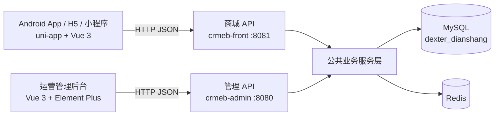

# 电商网购系统功能实现对照说明

> 核查依据：根目录 `功能.md` 第 1-13 行  
> 核查日期：2026-10-18  
> 核查范围：商城移动端、商城前台 API、管理后台、管理 API、MySQL 与 Redis

## 1. 结论

`功能.md` 列出的 9 项功能现已全部实现，状态为 **9/9 已实现**。

| 编号 | 需求 | 状态 | 主要入口 |
|---|---|---|---|
| 1 | 启动引导页和欢迎页 | 已实现 | `/pages/guide/index` |
| 2 | 主页商品分类展示 | 已实现 | `/pages/index/index`、`/pages/goods_cate/goods_cate` |
| 3 | 点击商品进入详情页 | 已实现 | `/pages/goods/goods_details/index?id={id}` |
| 4 | 选择数量并加入购物车 | 已实现 | 商品详情页、`POST /api/front/cart/save` |
| 5 | 删除购物车商品、批量下单、显示下单进度 | 已实现 | `/pages/order_addcart/order_addcart`、确认订单页 |
| 6 | 订单展示和删除 | 已实现 | `/pages/users/order_list/index` |
| 7 | 个人信息、修改密码、切换账号 | 已实现 | `/pages/infos/user_info/index` |
| 8 | 侧导航登录和注销 | 已实现 | 个人中心左侧账户抽屉 |
| 9 | 登录页注册账号 | 已实现 | `/pages/users/login/index?mode=register` |

管理端的商品信息管理和订单管理也已实现并通过页面及接口验收。

## 2. 系统架构

移动端使用 uni-app + Vue 3，可构建为 Android App、H5 和微信小程序；服务端使用 Spring Boot。

| 模块 | 目录 | 作用 |
|---|---|---|
| 商城移动端 | `frontend/uni-app` | 分类、商品、购物车、订单、账户与注册 |
| 管理后台 | `frontend/admin` | 商品和订单运营管理 |
| 商城 API | `backend/crmeb-front` | 面向商城客户端的 REST API |
| 管理 API | `backend/crmeb-admin` | 面向管理后台的 REST API |
| 公共模型和服务 | `backend/crmeb-common`、`backend/crmeb-service` | 数据模型、校验和业务逻辑 |
| 数据库脚本 | `backend/sql/Crmeb_v3.1.sql` | 数据库初始化脚本 |

## 3. 九项功能实现

### 3.1 启动引导页和欢迎页

**状态：已实现**

- `frontend/uni-app/pages.json` 将 `pages/guide/index` 配置为首个页面。
- `frontend/uni-app/pages/guide/index.vue` 从服务端读取开屏配置。
- `frontend/uni-app/pages/guide/guide.vue` 展示轮播图片、倒计时和“跳过”按钮。
- 广告关闭、数据为空或请求失败时自动进入首页。
- 接口：`GET /api/front/splash/ad/info`。

### 3.2 主页商品分类展示

**状态：已实现**

- 首页：`frontend/uni-app/pages/index/index.vue`。
- 分类页：`frontend/uni-app/pages/goods_cate/goods_cate.vue`。
- 分类组件：`frontend/uni-app/pages/goods_cate/components/default_cate.vue`。
- 支持一级、二级分类展示及按分类加载商品。
- 接口：`GET /api/front/category`、`GET /api/front/products`。

### 3.3 点击商品进入详情页

**状态：已实现**

- 页面：`frontend/uni-app/pages/goods/goods_details/index.vue`。
- 路由携带商品 ID：`/pages/goods/goods_details/index?id={id}`。
- 展示图片、名称、价格、库存、规格、详情和评价。
- 接口：`GET /api/front/product/detail/{id}`。

原需求中的“书”按通用商品处理；后台录入图书商品后使用同一详情页。

### 3.4 选择数量并加入购物车

**状态：已实现**

- 商品详情页支持规格选择、数量加减、库存和最小购买量校验。
- 规格弹层：`frontend/uni-app/components/productWindow/index.vue`。
- 前端 API：`frontend/uni-app/api/store.js` 中的 `postCartAdd`。
- 接口：`POST /api/front/cart/save`。
- 数据表：`eb_store_cart`。

### 3.5 删除商品、批量下单和进度条

**状态：已实现**

- 购物车页面支持单选、全选、数量修改、所选商品删除和失效商品清理。
- 多个购物车条目可合并预下单并进入确认订单页。
- 接口：
  - `GET /api/front/cart/list`
  - `POST /api/front/cart/num`
  - `POST /api/front/cart/delete`
  - `POST /api/front/order/pre/order`
  - `POST /api/front/order/create`
- 确认订单页新增真实阶段进度：
  - `20%`：校验订单信息。
  - `55%`：提交订单。
  - `85%`：订单创建成功。
  - `100%`：进入支付页。
- `submitting` 和 `creatingOrder` 双重状态避免重复点击和重复创建订单。
- 地址、联系人、订阅授权、创建订单或页面跳转失败时统一复位，可再次提交。
- 实现文件：`frontend/uni-app/pages/order/order_confirm/index.vue`。

进度表示客户端可确认的实际业务阶段，不伪造服务端内部执行百分比。

### 3.6 订单展示和删除

**状态：已实现**

- 订单列表：`frontend/uni-app/pages/users/order_list/index.vue`。
- 订单详情：`frontend/uni-app/pages/order/order_details/index.vue`。
- 支持待付款、待发货、待收货、待评价和已完成等状态分类。
- 支持详情、支付、取消、收货、评价、再次购买和符合规则的订单删除。
- 未付款订单不能直接执行完成订单删除；取消订单按项目既有模型进行软删除。
- 删除接口：`POST /api/front/order/del`。
- 数据表：`eb_store_order`、`eb_store_order_info`。

### 3.7 个人信息、修改密码和切换账号

**状态：已实现**

- 个人资料页：`frontend/uni-app/pages/infos/user_info/index.vue`。
- 修改密码页：`frontend/uni-app/pages/infos/user_pwd_edit/index.vue`。
- 资料页展示头像、昵称、手机号、用户 ID、地址和协议入口。
- 新增独立“切换账号”按钮。
- 切换账号前显示确认框，确认后注销当前身份并进入登录页。
- 服务端注销失败时仍清理本地 Token、UID、用户资料和微信授权缓存，避免残留登录态。

### 3.8 侧导航登录和注销

**状态：已实现**

- 组件：`frontend/uni-app/components/accountDrawer/index.vue`。
- 入口：个人中心左上角固定账户菜单按钮。
- 游客状态提供“登录”和“注册新账号”。
- 登录状态提供个人资料、切换账号和退出登录。
- 切换账号和退出登录均有确认保护。
- 抽屉先关闭再显示确认框，避免抽屉层遮挡确认框。
- 个人中心集成：`frontend/uni-app/pages/user/index.vue`。

### 3.9 登录页注册账号

**状态：已实现**

前端：

- 登录页增加“登录 / 注册”分段控制。
- 支持 `?mode=register` 直接打开注册模式。
- 注册字段包括手机号、6 位验证码、密码、确认密码和协议确认。
- 前端校验手机号、验证码、密码规则和两次密码一致性。
- 注册成功后保存 Token、UID 和用户资料并自动登录。
- 前端 API：`frontend/uni-app/api/user.js` 中的 `register`。

后端：

- 匿名接口：`POST /api/front/register`。
- 请求模型：`backend/crmeb-common/src/main/java/com/zbkj/common/request/RegisterRequest.java`。
- 控制器：`backend/crmeb-front/src/main/java/com/zbkj/front/controller/LoginController.java`。
- 服务实现：`backend/crmeb-front/src/main/java/com/zbkj/front/service/impl/LoginServiceImpl.java`。
- 重复手机号在读取或消费验证码前拒绝。
- 用户创建和密码设置处于同一事务。
- 只有注册成功后才删除 Redis 验证码。
- 注册成功直接签发前台 Token。

## 4. 管理端功能

### 4.1 商品管理

- 页面：`frontend/admin/src/views/store/index.vue`。
- 支持商品查询、分类筛选、上下架、编辑、库存、回收站和新增商品。
- 对应管理 API 和 `eb_store_product` 相关数据表。

### 4.2 订单管理

- 页面：`frontend/admin/src/views/order/index.vue`。
- 支持订单查询、状态分类、详情、编辑和后续履约操作。
- 商城新建订单可在管理后台查询。

## 5. 验收结论

详细测试命令、覆盖范围和结果见 `功能验收测试报告.md`。

- 后端全量测试：14 个测试，全部通过。
- 页面端到端测试：25/25 通过。
- H5、Android App、微信小程序和管理后台构建均成功。
- 已验证订单创建并进入支付页；按验收边界未执行真实支付或真实扣款。
- 原始需求文件 `功能.md` 未修改。
